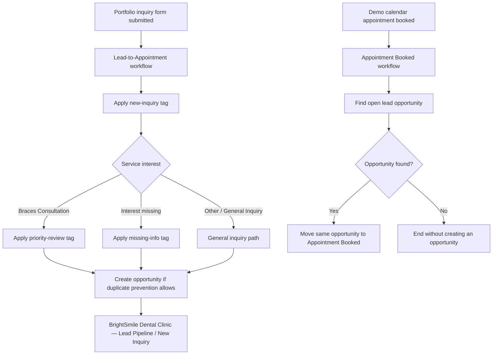

# BrightSmile Dental Clinic — Lead-to-Appointment CRM Automation

A fictional GoHighLevel (GHL) portfolio project demonstrating how a dental inquiry can enter a CRM pipeline, receive classification tags, and move to an appointment-booked stage when a matching demo-calendar booking is made.

> **Project status:** Portfolio demonstration only. The workflows are intentionally kept in **Draft**. Execution evidence describes the tested configuration and observed test run; it does not mean the workflows are published or production-ready.

## Project goals

- Capture a fictional dental inquiry through a clearly labeled portfolio form.
- Classify an inquiry by service interest and apply appropriate tags.
- Create a lead opportunity in the intended pipeline and initial stage.
- Find the existing open lead opportunity when a demo appointment is booked.
- Move that same opportunity to **Appointment Booked**, without creating a second opportunity.
- Keep outbound email, SMS, and WhatsApp actions disabled for this demonstration.
- Document configuration, test evidence, safety boundaries, and known limitations.

## Workflow architecture



The diagram describes the intended configured logic. Check the screenshots and test-results section for the exact behavior observed in the tested run.

## Tools

- **GoHighLevel:** Forms, calendars, contacts, tags, workflows, opportunities, execution logs.
- **GitHub:** Versioned documentation and screenshot evidence.
- **Markdown / Mermaid:** Project documentation and workflow architecture.

## Workflows

### 1. Lead-to-Appointment

**Trigger:** Submission of the portfolio inquiry form, filtered to `PORTFOLIO DEMO — BrightSmile Inquiry Form`.

Configured behavior:
- Apply `brightsmile-new-inquiry`.
- Route based on service interest.
- Apply `brightsmile-priority-review` for Braces Consultation.
- Apply `brightsmile-missing-info` when the configured missing-interest condition matches.
- Create an opportunity in **BrightSmile Dental Clinic — Lead Pipeline**, at **New Inquiry**, with duplicate opportunities disabled in the action settings.
- Keep the general-inquiry fallback path explicit.

### 2. Appointment Booked

**Trigger:** Customer books an appointment on `PORTFOLIO DEMO — BrightSmile Consultation`.

Configured behavior:
- Find an existing open opportunity in the intended pipeline.
- If found, move that opportunity to **Appointment Booked**.
- Prevent movement to an earlier stage when the relevant action setting is available and enabled.
- If no opportunity is found, end without creating a new one.
- Do not send outbound email, SMS, or WhatsApp messages in this demo.

## Test evidence and results

Record only what the saved execution logs and current CRM records actually show. Replace the status text below if later evidence contradicts it.

| Test area | Evidence to capture | Reporting guidance |
|---|---|---|
| Lead intake | Successful workflow execution log | State the branch and actions visible in the log. |
| Opportunity creation | Create Opportunity execution detail and contact opportunity panel | Confirm the pipeline, initial stage, and opportunity count from the UI. |
| Appointment booking | Booking workflow execution log | Confirm the booking trigger and Find Open Lead Opportunity result. |
| Stage update | Move action result and opportunity detail | Verify the same opportunity was moved to Appointment Booked. |
| No outbound messages | Workflow canvas and notification settings | Describe the configured absence of outbound-message actions; do not imply broader system-wide suppression. |
| Appointment cancellation | Contact Appointments panel | The test appointment was cancelled, while the opportunity remained at Appointment Booked. This is a known limitation, not proof of cancellation handling. |

### Known limitation: cancellation handling

The test appointment was cancelled, but the opportunity remained in **Appointment Booked**. Cancellation-triggered stage rollback or reconciliation is not implemented/verified in this demo and is a planned improvement.

### Important evidence boundary

A successful test execution proves the behavior observed in that test scenario only. It does not establish that every edge case works, that the workflows are production-ready, or that the configuration is legally compliant.

## Screenshot evidence

Store screenshots in `screenshots/` using the exact filenames in the companion capture checklist. Recommended high-value evidence includes:
- Both workflow canvases and their trigger filters.
- Both successful execution logs and relevant action details.
- The same opportunity before/after the stage update, where history is available.
- The portfolio form's consent wording and redirect.
- Demo calendar configuration and public booking page.
- The cancelled test appointment and the opportunity's unchanged stage.
- The final workflow list showing both portfolio workflows in Draft.

## Safety, privacy, and isolation

- Use fictional contacts and reserved example email addresses only.
- Before committing screenshots, blur test email addresses, phone numbers, contact IDs, opportunity IDs, calendar/booking identifiers, and unrelated records.
- Never commit CRM exports, credentials, API keys, access tokens, session cookies, or private customer/patient information.
- Keep the original BrightSmile workflows and forms isolated. Do not change or publish unrelated workflows as part of this portfolio demo.
- Keep both portfolio workflows in **Draft** unless a deliberate, separately reviewed test requires otherwise.
- Replace or obscure any real office phone number or other identifying information visible in a confirmation page before public display.

## Repository structure

```text
BrightSmile-Lead-to-Appointment-Automation/
├── README.md
├── screenshots/
│   ├── 01-account-workflow-overview/
│   ├── 02-lead-intake-workflow/
│   ├── 03-intake-execution-evidence/
│   ├── 04-portfolio-inquiry-form/
│   ├── 05-demo-calendar/
│   ├── 06-appointment-booked-workflow/
│   ├── 07-booking-execution-evidence/
│   ├── 08-test-contact-opportunity/
│   ├── 09-safety-isolation/
│   └── 10-final-documentation/
└── documentation/
    └── (optional sanitized supporting documentation)
```

## Disclaimer

BrightSmile Dental Clinic and the portfolio records are fictional. This project is for learning and portfolio demonstration only. It is not a live clinic system, a guarantee of automation reliability, or a legal, privacy, or healthcare-compliance assessment.
