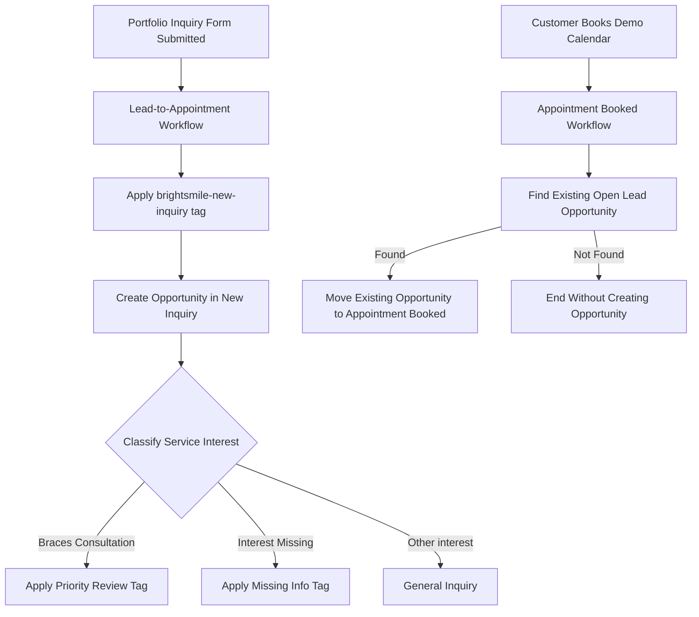
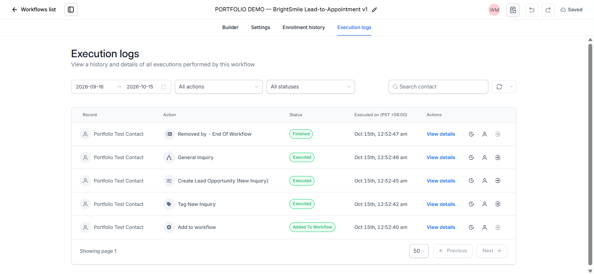

# BrightSmile Dental Clinic --- Lead-to-Appointment CRM Automation Demo

A portfolio project demonstrating lead intake, contact tagging,
opportunity creation, and appointment-driven pipeline updates in
GoHighLevel (GHL), using fictional dental-clinic data.

> **Project status:** Portfolio demo. The two portfolio workflows remain
> in **Draft**. The workflow runs shown below are evidence of the tested
> executions, not a claim that these automations are published for live
> use. This is not a production deployment or a legal, privacy, or
> healthcare-compliance assessment.

## Project Overview

BrightSmile Dental Clinic is a fictional clinic used to demonstrate how
an inquiry can enter a CRM pipeline and how a subsequent appointment
booking can update the existing opportunity.

The project focuses on two portfolio workflows:

1.  **Lead-to-Appointment** --- responds to the portfolio inquiry form
    submission, applies a lead tag, creates an opportunity in the New
    Inquiry stage, and classifies the inquiry by service interest.
2.  **Appointment Booked** --- responds to a booking on the portfolio
    demo calendar, searches for an existing open lead opportunity, and
    moves the found opportunity to Appointment Booked.

The workflows were built and tested in a GoHighLevel demo account. All
records are fictional portfolio test data.

## Project Goals

-   Demonstrate form-triggered lead intake.
-   Apply tags for inquiry tracking and review.
-   Create a lead opportunity in the intended pipeline and initial
    stage.
-   Route inquiries according to service interest, including priority
    review and missing-interest branches.
-   Find an existing open opportunity when an appointment is booked.
-   Update the existing opportunity instead of creating a second
    opportunity.
-   Preserve the original published workflow and keep the portfolio
    workflows in Draft.
-   Document actual test evidence and known limitations clearly.

## Tools Used

-   **GoHighLevel (GHL):** Forms, calendars, contacts, tags, workflows,
    opportunities, pipeline stages, and execution logs.
-   **GitHub:** Portfolio documentation and screenshots.
-   **Markdown / Mermaid:** Project documentation and workflow
    architecture.

## Workflow Architecture



## Workflow Details

### 1. Lead-to-Appointment

**Trigger:** The portfolio inquiry form is submitted.

**Configured behavior:**

-   Apply the `brightsmile-new-inquiry` tag.
-   Create an opportunity in the **BrightSmile Dental Clinic --- Lead
    Pipeline**, initially at **New Inquiry**, with duplicate-opportunity
    creation disabled in the action configuration.
-   Classify the service interest.
-   For **Braces Consultation**, apply `brightsmile-priority-review`.
-   If service interest is missing, apply `brightsmile-missing-info`.
-   Route other service interests through the General Inquiry branch.

**Observed evidence:** The execution log shows the test contact entering
the workflow, the new-inquiry tag action executing, the
opportunity-creation action executing, the General Inquiry branch being
taken, and the workflow finishing.

**Limitations:** The displayed successful run demonstrates the General
Inquiry branch. Do not treat it as proof that every branch or every
possible duplicate-submission scenario has been tested.


### 2. Appointment Booked

**Trigger:** A customer books an appointment on the portfolio demo
calendar.

**Configured behavior:**

-   Find the contact's existing open opportunity in the BrightSmile
    Dental Clinic --- Lead Pipeline.
-   If an opportunity is found, move it to **Appointment Booked**.
-   If no opportunity is found, follow the Not Found branch without
    creating a new opportunity.
-   The workflow contains no outbound-message actions.

**Observed evidence:** The execution log shows the booking trigger, the
Find Open Lead Opportunity action, and the Move to Appointment Booked
action executing successfully. The test contact's activity also shows
the opportunity being moved from New Inquiry to Appointment Booked.

**Known limitation:** The test appointment was later cancelled, but the
opportunity remained at Appointment Booked. Cancellation handling is a
planned improvement and is not currently implemented by this workflow.


## Screenshots

The screenshots below show the workflow configuration and the test
evidence available at the time of documentation. They are organized by
their purpose; unrelated template screenshots are included only as
optional account-context evidence.

### Account and workflow overview


The workflow list shows the two portfolio workflows in Draft. It also
shows the original **BrightSmile --- New Lead Intake** workflow as
Published. Keep the original workflow unchanged.

### Lead intake execution evidence



The execution log shows the portfolio test contact's run, including the
tag action, opportunity-creation action, General Inquiry branch, and
successful workflow completion.

### Appointment-booking execution evidence


The execution log shows the booking workflow finding the existing open
lead opportunity and moving it to Appointment Booked.

### Test contact and cancelled appointment


This screenshot shows the fictional test contact, the
`brightsmile-new-inquiry` tag, opportunity activity, and the cancelled
test appointment. The appointment was cancelled after the booking
workflow test; the opportunity remained at Appointment Booked.

**Privacy note:** Blur or remove the test email address, phone number,
and any other personal or account identifiers before publishing this
screenshot publicly.

### Calendar view


This is supporting evidence of the test appointment in the calendar. It
is not a substitute for screenshots of the demo calendar's configuration
or public booking page.

### Other workflow templates --- optional context

These are unrelated template workflows visible in the GHL account. They
are not part of the two-workflow portfolio demonstration. They should
remain in Draft and should not be described as implemented or tested
parts of this project.

```{=html}
<details>
```
```{=html}
<summary>
```
Show optional template screenshots
```{=html}
</summary>
```
#### New Lead Nurture --- Claim Offer


#### Appointment Confirmation + Reminders


#### Appointment No Show


#### New Sale --- Send Review Request


#### Long-Term Nurture


#### Stale Leads


```{=html}
</details>
```
## Test Results

  ---------------------------------------------------------------------------
  Test area               Observed evidence           Status / limitation
  ----------------------- --------------------------- -----------------------
  Lead intake trigger     Form-submission run appears Observed in the
                          in execution logs           recorded test

  New inquiry tag         `brightsmile-new-inquiry`   Observed in the
                          action executed             recorded test

  Opportunity creation    Create Lead Opportunity     Observed in the
                          action executed for the     recorded test
                          test contact                

  General Inquiry branch  Execution log shows the     Observed in the
                          General Inquiry branch      recorded test

  Appointment booking     Booking workflow run        Observed in the
  trigger                 appears in execution logs   recorded test

  Find open opportunity   Find Open Lead Opportunity  Observed in the
                          action executed             recorded test

  Opportunity stage       Existing opportunity moved  Observed in the
  update                  to Appointment Booked       recorded test

  Duplicate opportunity   Action configuration is     Do not generalize
  handling                intended to prevent         beyond tested scenarios
                          duplicates; booking         
                          workflow searches for an    
                          existing open opportunity   

  Cancelled appointment   Appointment was cancelled,  Known limitation; not
  handling                but opportunity remained at implemented
                          Appointment Booked          

  Outbound messages       No outbound-message actions Confirmed from the
                          in the Appointment Booked   workflow canvas
                          workflow                    

  Every intake branch     Not all branches are        Additional branch
                          evidenced by the displayed  testing would be needed
                          run                         
  ---------------------------------------------------------------------------

## Pipeline

The configured BrightSmile Dental Clinic --- Lead Pipeline includes
these stages:

1.  New Inquiry
2.  Contacted
3.  Appointment Booked
4.  Attended

Completed/converted and lost outcomes are represented as opportunity
statuses rather than additional active pipeline stages.

## Safety and Scope

-   BrightSmile Dental Clinic is fictional.
-   Use fictional test records only.
-   The two portfolio workflows remain in Draft.
-   The original **BrightSmile --- New Lead Intake** workflow remains
    Published and should not be changed as part of this portfolio
    project.
-   Other unrelated workflows remain in Draft.
-   No production deployment or live clinic use is claimed.
-   Screenshots should be reviewed for email addresses, phone numbers,
    contact IDs, opportunity IDs, account details, and unrelated records
    before public upload.
-   Do not upload CRM exports, credentials, API keys, access tokens, or
    private customer data.

## Known Limitations and Next Steps

-   Add handling for appointment cancellation so an opportunity does not
    remain at Appointment Booked after a cancelled booking.
-   Capture configuration screenshots for the demo calendar, inquiry
    form, consent wording, form redirect, and booking page if a more
    complete configuration audit trail is desired.
-   Add further tests for intake branches and duplicate-submission
    scenarios.
-   Continue to distinguish observed test results from configuration
    intent and future improvements.

## Disclaimer

This project is intended for learning and portfolio demonstration only.
It is not a live clinic system, a guarantee of automation reliability,
or a legal, privacy, or healthcare-compliance review.
